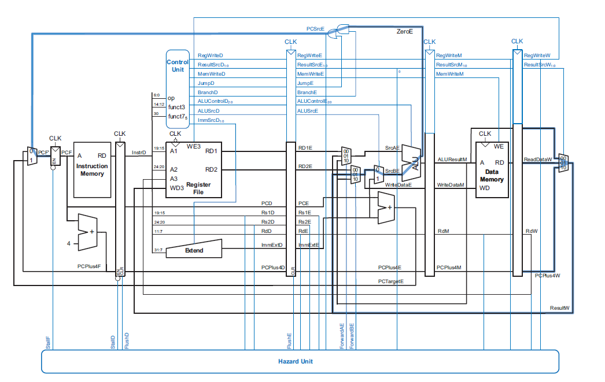

# Pipelined RISC-V RV32I CPU (VHDL)

[](https://github.com/OmarOthmeni/PIPELINED_RISC-V_R32I/actions/workflows/tests.yml)

A 5-stage pipelined CPU implementing the RISC-V **RV32I** base integer ISA, written in VHDL, with a
bare-metal C toolchain flow and a self-checking simulation test suite that runs on every push.



## Highlights

- **5-stage pipeline**: fetch, decode, execute, memory, write-back; Harvard architecture.
- **Hazard unit**: operand forwarding from the memory and write-back stages, a one-cycle stall for
  load-use hazards, and a pipeline flush on taken branches and jumps (static not-taken prediction).
- **Full RV32I user-level integer set** except `FENCE`, `ECALL` and `EBREAK`; 8/16/32-bit loads and
  stores with sign/zero extension, little-endian, byte-addressable data memory.
- **C runs on it**: startup code (stack, `.bss` clearing, `.data` copy), a linker script for the
  memory map, and a Makefile that turns any C or assembly program into the ROM contents.

## Verification

`scripts/run_tests.sh` compiles each program in `sw/tests/`, loads it into the CPU, simulates it with
GHDL and checks the result reported by the program itself:

| Program | What it checks | Result |
|---|---|---|
| `isa_test.S` | 44 checks: arithmetic, logic, shifts, compares, `LUI`/`AUIPC`, all 6 branches, `JAL`/`JALR`, all load/store widths with sign extension, forwarding chains, load-use stall, store-data forwarding, `x0` | PASS (343 cycles) |
| `c_test.c` | Fibonacci, recursive factorial (stack + libgcc soft multiply), CRC-32, software division, bubble sort | PASS (1,683 cycles) |

Programs report through a `tohost` mailbox at `0x00FC8100` (1 = pass, `(n << 1) | 1` = test `n`
failed); `tb/tb_cpu_selfcheck.vhd` watches the CPU's store port for it, with a cycle timeout.

The suite found and fixed three bugs that the original single demo program never exercised:

1. **Shifts** used all 32 bits of `rs2` as the shift amount; RV32I uses only `rs2[4:0]`
   (`sll x3, x1, 33` must shift by 1). Large values also crashed simulation.
2. **Data-memory decoding** converted addresses with `to_integer`, which overflows for any value
   ≥ `0x80000000`; since the ALU result drives the address bus, a plain `add` producing such a value
   stopped the simulation. Addresses are now compared as `unsigned`.
3. **Linker script** only collected `.text`/`.data`; at `-O2` GCC places `main` in `.text.startup`,
   so optimized programs were silently missing from instruction memory.

## Memory map

| Region | Base | Size |
|---|---|---|
| Instruction memory | `0x00000000` | sized to the program (up to 8 KB in the linker script) |
| Data ROM (`.rodata`, initial `.data`) | `0x00FC8000` | 256 B |
| Data RAM (`tohost`, `.data`, `.bss`, stack) | `0x00FC8100` | 512 B |

## Quick start

Requirements: [GHDL](https://github.com/ghdl/ghdl) and a bare-metal RISC-V GCC
(e.g. the [xPack](https://github.com/xpack-dev-tools/riscv-none-elf-gcc-xpack) `riscv-none-elf-gcc`).

```bash
# run the whole test suite
bash scripts/run_tests.sh

# build your own program and load it into src/memory_package.vhd
make -C sw PROG=examples/main.c
```

`make` compiles the program, extracts the code and constant-data sections, and regenerates
`src/memory_package.vhd` with `scripts/gen_memory_package.py`. Use `RISCV_PREFIX=` if your
toolchain has a different prefix (e.g. `riscv64-unknown-elf-`).

## Repository layout

```
src/        CPU RTL (pipeline registers, decoder, control, ALU, hazard unit, memories)
tb/         CPU_tb.vhd (free-running) and tb_cpu_selfcheck.vhd (pass/fail)
sw/         startup.S, linker.ld, Makefile, examples/, tests/
scripts/    gen_memory_package.py, run_tests.sh
```

## Limitations and next steps

- No interrupts or exceptions; invalid or misaligned instructions are detected but not trapped.
- Verified in simulation only; FPGA synthesis (resource usage, Fmax) is the next step.
- Memories are VHDL constants, so a new program means re-running `make` before simulation.
